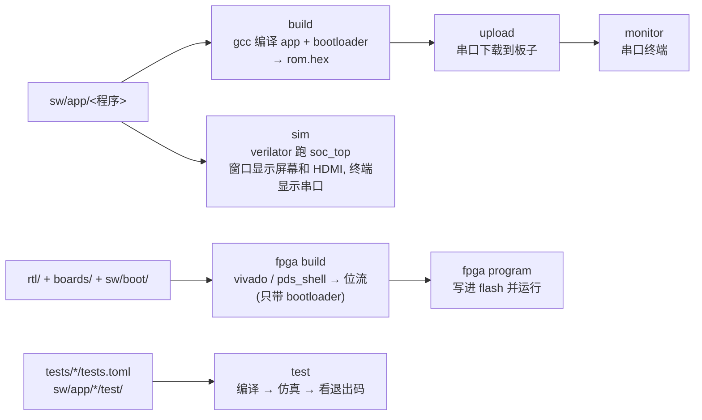

# ama

仓库里编译、下载、仿真、测试、出位流都只走根目录的 `ama`。`./ama --help` 看命令, `./ama <命令> --help` 看参数。

## 每个命令做什么

`run` = build + upload + monitor, 平时改了 C 就用它。

| 命令 | 输入 | 产出 |
| --- | --- | --- |
| `build <程序>` | `sw/` 各层 + `sw/app/<程序>/` + `sw/boot/` | `build/fw/<板>/<程序>/` 下 app.elf、boot.elf、rom.hex |
| `run` / `upload <程序>` | 同上 | 板子上跑起来 |
| `sim <程序>` | 同上 (按盘古编译, 不带 bootloader) + `sim/` 外壳 | 窗口显示屏幕和 HDMI, 终端显示串口; 在窗口里打字 = 往串口发字符; 结束时截图 `build/sim/<程序>-lcd.png`、`-hdmi.png` |
| `test [路径]` | `tests.toml`、`sw/app/*/test/` | 每个测试一行 PASS/FAIL, 日志在 `build/test/` |
| `fpga build [--app <程序>]` | bootloader + `rtl/` + `boards/<板>/` | `build/fpga/<板>/` 下的位流, 上电等下载; 加 `--app` 把程序固化进去 (`build/fpga/<板>-<程序>/`), 上电直接运行 |
| `fpga program [--app <程序>] [--once]` | 上面的位流 | 写进板上 flash (上电自动加载) 并马上运行; `--once` 只下载到 FPGA, 断电就丢 |
| `new <程序>` | 模板 `sw/app/hello/` | `sw/app/<程序>/`: main.c + 两块板的 `boards/<板>/app_board.h`, 直接能编 |
| `gen pins <板>` | `boards/<板>/pins.csv` | 引脚约束、`pins_top.vh`、`sw/bsp/<板>_pins.h` |
| `doctor` | `ama.local.toml` | 每个外部工具实际调用的命令和版本 |
| `lint` / `fmt` | Python、C、Verilog 源码 | 问题列表; 加 `--fix` 直接改文件 |

板子不写 `--board` 时按插着的 USB 串口芯片识别。下载前会核对板上位流的硬件版本号和本地源码是否一致,
不一致要先 `fpga build` + `fpga program`。

## 规则

- **ROM 分区**: 只在 `sw/memory.ld` 定义; 两份链接脚本和 ama 都从它读; RTL (rom.v 写保护、板级顶层 RESET_PC) 另有同值常量。
- **一个编译器**: 固件只用 `riscv32-unknown-elf-gcc`。电脑端测试 (`sw/app/*/test/`) 在电脑上运行, 用电脑的 `cc`。
- **本机工具**: ama 调用的外部程序都按名字找, 本机名字或位置不同时在 `ama.local.toml` 里写替代命令,
  规则见 [`ama.local.toml.example`](../../ama.local.toml.example)。
- **程序**: `sw/app/<程序>/` 下的 .c 一起编译; `boards/<板>/` 子目录放该板的接线; 要额外源文件或选项时写
  `app.toml` (`sources`、`include`、`cflags`)。
- **测试**: 每个测试目录一个 `tests.toml`, 一个 `[[test]]` 是一个测试台, 判定只看仿真退出码 (0 = PASS)。
  字段: `tb`、`rtl`、`extra`、`params` (每组编译一次)、`runs` (每项运行一次: `app` 或 `program`、`defines`、
  `plusargs`、`link`、`ram_init` (默认 true: 从 ELF 预填 RAM; false: 由固件 startup 从 ROM 初始化))、`expect = "fail"`。
  测试台输出的 `[result]` 行内容会附在该测试的 PASS/FAIL 行后面。
- **sim 是一块虚拟的盘古板**: `sim/sim_top.sv` 例化真实的 `mes50hp_top`, 屏幕模型和串口接在板子的脚上
  (`pins_top.vh` 里的 `PIN_<名字>`), 固件按盘古编译。

## 代码

| 文件 | 内容 |
| --- | --- |
| `cli.py` | 全部命令 |
| `firmware.py` | 编译、ELF → ROM 镜像、硬件版本号 |
| `load.py` | 串口 bootloader 协议 |
| `fpga.py` | 生成 FPGA 工程, 跑 Vivado / PDS, 检查结果 |
| `testing.py` | 解释 tests.toml |
| `boards.py` | 读 `board.toml`, 生成引脚文件 |
| `local.py` | 读 `ama.local.toml` |
| `lint.py` | lint / fmt |
